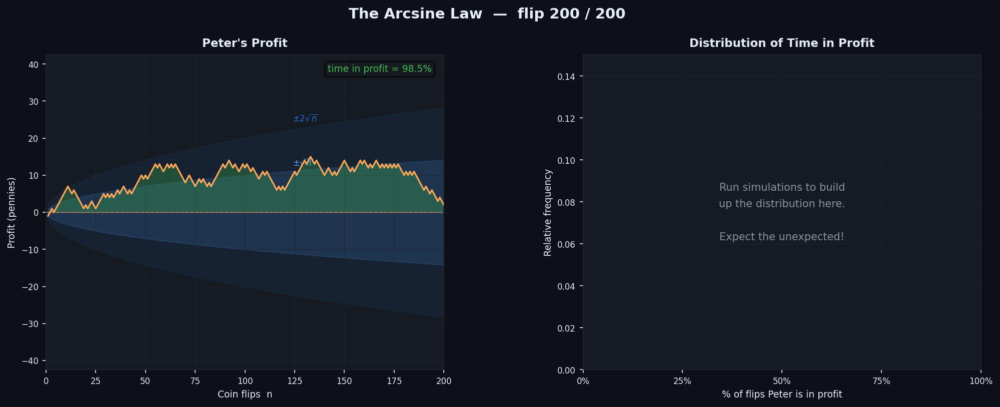
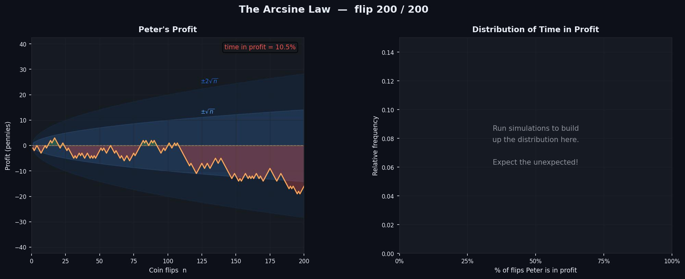
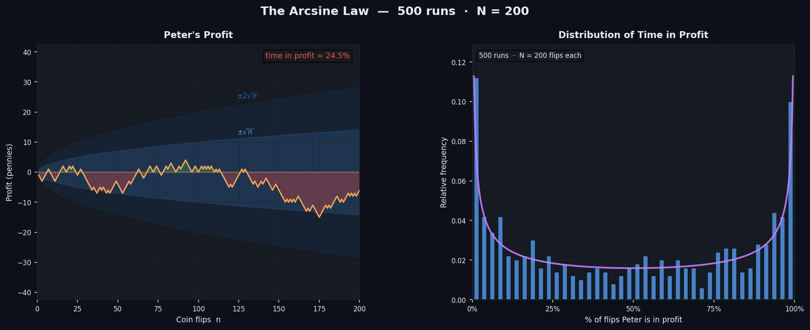

# Random Walk Simulations — Teaching Tool

An interactive collection of probability and statistics simulations, built with Python and Matplotlib.

## Project structure

```
random_walk/
├── main.py                        # Entry point — run this
├── src/
│   ├── menu.py                    # Simulation selection menu
│   └── simulations/
│       ├── simulation_1.py        # Peter and Paul — Coin Flip Game
│       ├── simulation_2.py        # The Arcsine Law — Time in Profit
│       ├── simulation_3.py        # Coin Toss Random Walk
│       ├── simulation_{4,5,6}.py  # Placeholders for future simulations
│       └── _placeholder.py        # Shared placeholder window
└── tests/
    ├── test_simulation_1.py       # Test suite for simulation 1
    ├── test_simulation_2.py       # Test suite for simulation 2
    └── test_simulation_3.py       # Test suite for simulation 3
```

## Running the tool

Requires Python 3.14+ and [uv](https://docs.astral.sh/uv/).

```bash
uv sync              # install dependencies (first run only)
uv run python main.py
```

A numbered menu is printed in the terminal. Enter a number to launch a simulation; close its window (or click **Return to Menu**) to go back to the menu. Enter `0` to quit.

## Running the tests

```bash
uv run pytest
```

---

## Simulation 1 — Peter and Paul: Coin Flip Game

An interactive visualisation of a simple gambling game between two players.

### The game

Peter and Paul flip a fair coin repeatedly. Peter wins a penny from Paul on heads, and loses a penny to Paul on tails. The game runs for 500 flips.

### What it shows

| Panel | Content |
|-------|---------|
| Left — Peter's Profit | Peter's cumulative profit over time. Green fill above zero (Peter leads), red fill below (Paul leads). ±1σ and ±2σ bands show the expected spread. |
| Right — Previous Runs | A growing gallery of archived runs, each in a distinct colour, showing how different individual paths can be despite sharing the same underlying distribution. |

### The mathematics

Each flip is a Bernoulli trial with p = ½. Let profit_n = (heads − tails) after n flips:

- **E[profit_n] = 0** — the game is fair.
- **Var(profit_n) = n**, giving **SD(profit_n) = √n**.
- **Parity invariant**: profit_n ≡ n (mod 2) — after an odd number of flips the profit is always odd, and vice versa.
- profit_n = 2 W_n where W_n is the walk from Simulation 3, so its standard deviation is exactly double.
- By the Central Limit Theorem, profit_n is approximately Normal(0, √n) for large n.

### Controls

| Control | Action |
|---------|--------|
| **Start / Stop** | Begin or pause the animation |
| **New Run** | Archive the current run to the gallery and start a fresh one |
| **Speed slider** | Set how many flips are revealed per frame (1–50) |
| **Return to Menu** | Close the window and return to the simulation menu |

Runs that reach all 500 flips are archived to the gallery automatically.

---

## Simulation 2 — The Arcsine Law: Time in Profit

An interactive demonstration of one of probability's most surprising results: in a fair coin-flip game, the most likely outcome is that one player leads for almost the entire game — not that the lead changes hands roughly equally.

### The question

Peter and Paul play the coin-flip game from Simulation 1 for N flips. After the game, what fraction of the time was Peter in profit? Students typically guess the answer peaks near 50% — that is, they expect Peter and Paul to swap the lead roughly equally. The arcsine law says the opposite is true.

### What it shows

| Panel | Content |
|-------|---------|
| Left — Peter's Profit | One animated walk with green/red shading and a live **"time in profit"** counter. ±1σ and ±2σ bands are labelled as in Simulation 1. |
| Right — Distribution of Time in Profit | A histogram that grows with each completed run, showing the fraction of flips Peter spent in profit. With enough runs the U-shape of the arcsine distribution becomes clear. Toggle **Show Theory** to overlay the theoretical curve. |

### The mathematics

Let L_n be the number of steps (out of n) for which Peter's profit is strictly positive. As n → ∞, the fraction L_n / n converges in distribution to the **arcsine distribution** — a Beta(½, ½) random variable whose PDF is:

$$f(p) = \frac{1}{\pi\sqrt{p(1-p)}}, \quad p \in (0,1)$$

Key properties of this distribution:

- **Mean = ½** — on average Peter is in profit half the time.
- **Variance = ⅛** — but there is enormous spread around that average.
- **U-shaped PDF** — the density is minimised at p = ½ and diverges at both endpoints. Spending roughly half the time in profit is actually the *least* likely outcome; spending almost all (or almost none) of the time in profit is the most likely.
- The probability of Peter being in profit for fewer than 10% or more than 90% of the time is about **40%** — far higher than intuition suggests.

The "Show Theory" overlay plots f(p) scaled to match the histogram's bin width, confirming that the empirical distribution converges to this U-shaped curve.

### Controls

| Control | Action |
|---------|--------|
| **Start / Stop** | Begin or pause the animation for the current walk |
| **New Run** | Stop and generate a fresh walk (does not reset the histogram) |
| **Reset** | Clear the histogram and start fresh |
| **Show / Hide Theory** | Toggle the arcsine curve overlay on the histogram |
| **Speed slider** | Set how many flips are revealed per frame (1–50) |
| **Coin flips N slider** | Set the length of each walk (20–1,000); takes effect on the next New Run or Reset |
| **Return to Menu** | Close the window and return to the simulation menu |

Each completed walk (all N flips) adds one data point to the histogram. Run many walks to see the U-shape emerge.

### Screenshots

**Peter leads for almost the entire game (98.5% of flips in profit)**



**Paul leads for almost the entire game (only 10.5% of flips in profit for Peter)**



**After 500 runs — the U-shaped arcsine distribution emerges, with theory overlay**



---

## Simulation 3 — Coin Toss Random Walk

An interactive visualisation of fluctuations in a random walk.

### What it shows

When a fair coin is tossed repeatedly, three quantities evolve in distinctly different ways:

| Panel | Quantity | Standard deviation | Behaviour |
|-------|----------|--------------------|-----------|
| Left | Heads minus expected &nbsp; W_n = H_n − n/2 | ½√n | Wanders, grows in magnitude |
| Centre | Distribution of W_n across 500 independent walks | ½√n | Histogram spreads and converges to Normal(0, ½√n) |
| Right | Proportion of heads &nbsp; H_n / n | ½ / √n | Converges to 0.5 |

The centre panel makes the Central Limit Theorem visible: at small n the histogram is lumpy and discrete; at large n it converges to the overlaid Normal(0, ½√n) curve. The ±1σ and ±2σ dashed lines track the growing spread, mirroring the shaded bands on the left panel.

### The mathematics

Each toss is a Bernoulli trial with p = ½. After n tosses:

- **E[H_n] = n/2**, so W_n = H_n − n/2 has mean zero.
- **Var(W_n) = n · p(1−p) = n/4**, giving **SD(W_n) = ½√n**.
- H_n/n = W_n/n + ½, so **SD(H_n/n) = ½/√n → 0** (Law of Large Numbers).
- By the Central Limit Theorem, W_n is approximately Normal(0, ½√n) for large n.

The centre panel runs 500 independent walks in parallel and displays their histogram of W_n at each step n. At small n, the histogram is visibly discrete (W_n can only take half-integer values); as n grows the bins fill in and the histogram converges to the overlaid theoretical Normal curve.

The shaded bands on each panel show the 1σ (brighter blue) and 2σ (darker blue) regions. A normally distributed walk stays within 2σ about 95% of the time.

### Controls

| Control | Action |
|---------|--------|
| **Start / Stop** | Begin or pause the animation |
| **Reset** | Generate a new random walk and restart |
| **Speed slider** | Set how many tosses are revealed per frame (1–200) |
| **Return to Menu** | Close the window and return to the simulation menu |

The n counter in the title updates as the walk progresses. At the default speed of 20 tosses per frame (~30 fps) the full 5,000-toss walk completes in roughly 8 seconds.
